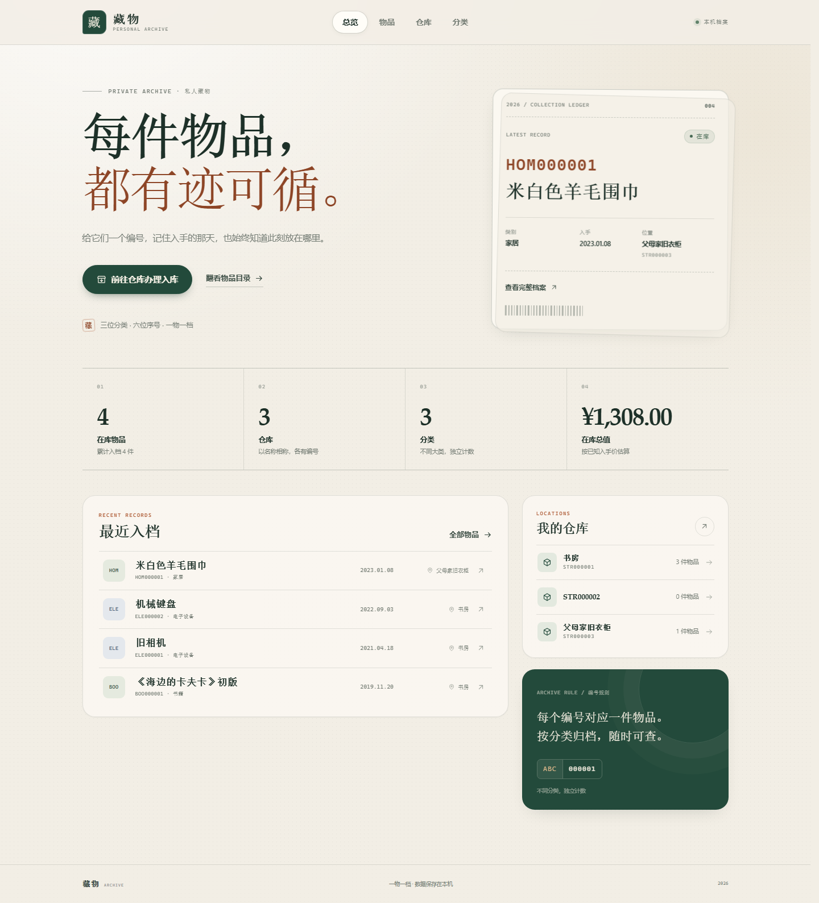
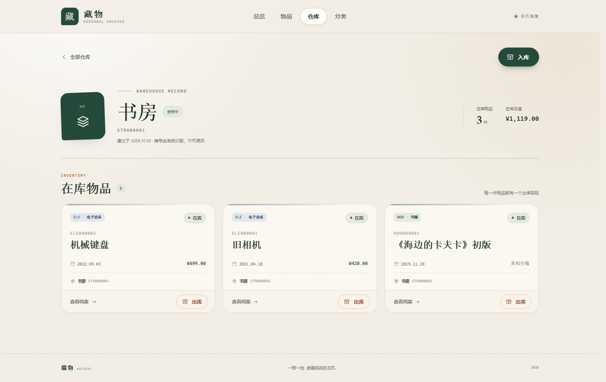
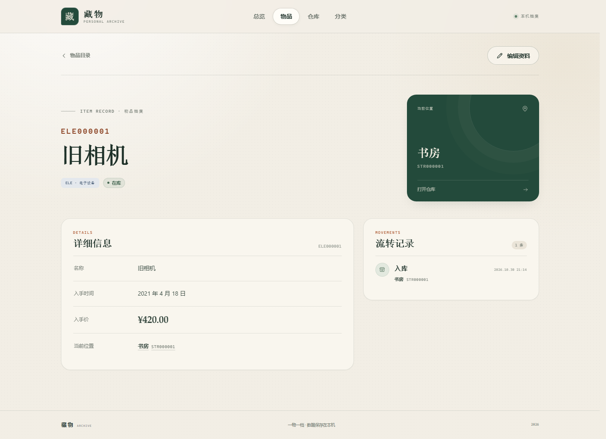
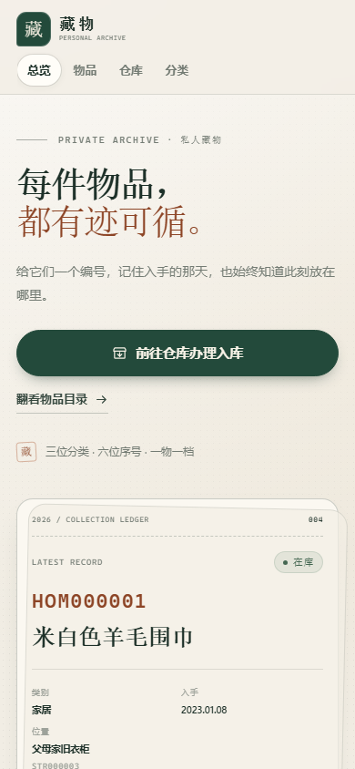

# 藏物 Archive

一个以 Web 为界面、Python 为后端的本地个人物品管理系统。物品有自己的编号与档案，仓库以名字相称，每次出入库都有迹可循。

不依赖任何第三方 Python 包，也不需要 Node.js 或数据库服务。数据保存在本机的 SQLite 文件中。



## 功能

- **物品编号**：`XXX` + 六位序号，`XXX` 是用户创建的三位分类代号，每个分类独立计数。
- **物品档案**：直接访问 `/ele000001` 这样的地址，即可查看名称、入手时间、入手价、当前位置。入手价填 `-1` 表示价格未知。
- **添加物品**：物品目录右上角有「添加物品」，选择分类与仓库后即可建档并入库；访问尚未建档的物品编号时也可以直接补录。若编号前缀对应的分类还不存在，会先要求创建该分类。
- **仓库管理**：仓库以名称为主，另有 `STR` + 六位唯一编号作为访问地址，例如 `/str000001`。
- **入库**：仓库页面右上角有「入库」按钮，可录入新物品，也可将已出库物品重新入库。
- **出库**：仓库内的每件物品下方都有「出库」按钮。出库只改变库存状态，不删除档案，之后可重新入库。
- **归档**：物品和仓库都可以归档，归档后会从日常列表中收起，档案与流转记录完整保留；随时可以「取消归档」恢复。
- **删除仓库**：从未有物品进入过的仓库可以直接删除；有历史记录的仓库不能删除，可以归档保留。
- **分类管理**：分类代号为三位英文字母；分类下没有物品时可以删除。
- **流转记录**：物品详情页显示每次入库 / 出库的时间与仓库。
- **本地优先**：使用系统字体和无外部依赖的静态前端，断网也可使用。



| 物品详情 | 移动端 |
| --- | --- |
|  |  |

> 截图中的物品均为演示数据。

## 环境要求

- Python 3.10 或更高版本
- 现代浏览器（推荐 Edge / Chrome / Firefox / Safari 的最新版本）

项目仅使用 Python 标准库，无需安装任何依赖。

## 启动

在项目目录中运行：

```powershell
python app.py
```

然后打开：

**http://127.0.0.1:8000**

也可以自定义端口或数据库路径：

```powershell
python app.py --port 8010
python app.py --db D:\archive\my-items.db
```

Windows 用户也可以双击 `run.cmd`，或在 PowerShell 中运行 `.\run.ps1`。

启动后：

- 访问地址：`http://127.0.0.1:<端口号>`
- 数据文件：默认 `data/archive.db`
- 停止服务：在终端按 `Ctrl+C`

如果页面提示「无法连接到后端服务」，请确认：

1. 运行 `python app.py` 的终端仍在运行，且端口与浏览器地址一致；
2. 没有重复启动多个服务实例占用同一端口（Windows 下重复绑定会得到明确的启动失败提示）；
3. 浏览器是通过 `http://127.0.0.1:<端口号>` 打开的，而不是直接双击 `static/index.html`。

## 第一次使用

1. 打开 **仓库**，点击「新建仓库」。先给仓库起个名字，例如「书房」「父母家」；系统会同时分配 `STR000001` 这样的编号。
2. 进入仓库详情页，点击右上角 **「入库」**。
3. 如果还没有分类，可在入库窗口中点击「新建分类」，输入三位字母，例如 `ELE`、`BOO`。
4. 填写物品名称、入手时间、入手价（价格未知可填 `-1`），系统会自动生成物品编号并写入当前位置。
5. 之后可通过物品编号地址（如 `/ele000001`）访问档案，或在仓库页面对物品执行出库。

也可以直接从 **物品** 目录页右上角点击「添加物品」录入：选择分类和目标仓库后即可建档。访问不存在的物品编号时，页面同样会提供「添加物品」入口；如果编号前缀对应的分类还未建立，会先引导创建分类。

## 编号规则

| 对象 | 格式 | 示例 | 说明 |
| --- | --- | --- | --- |
| 物品 | `XXX000000` | `ELE000001` | `XXX` 为分类代号，六位序号按分类独立递增 |
| 仓库 | `STR000000` | `STR000001` | `STR` 为仓库专用前缀，编号自动分配，作为仓库的地址 |

- 仓库以名称相称，编号是它的稳定地址；名称留空时，界面会直接以编号显示。
- 分类代号必须是 **3 位英文字母**，会自动转为大写；`STR` 是仓库保留前缀，不能用作分类。
- 序号从 `000001` 开始，左侧补零至六位，最大到 `999999`。
- 分类下没有物品时可以删除；分类中已有物品时不能删除，物品不能删除。
- 分类之间的计数器互不影响：`BOO000001` 和 `ELE000001` 可以同时存在。
- 出库再入库的物品会保留原编号。
- 物品的编号、分类和当前位置不会通过「编辑资料」被随意改动；位置变化必须经由入库 / 出库流程完成。
- 入手价填 `-1` 表示价格未知；未知价格不计入在库总值的估算。
- 归档不是删除，也不是出库：物品归档后从物品目录与库存统计中收起，编号、档案、位置与流转记录都会保留；取消归档后恢复原状。
- 归档中的物品不能入库或出库，需要先取消归档。
- 仓库中还有在库物品时不能归档；先把物品出库或归档后，再归档仓库。
- 归档仓库会从仓库列表和总览中收起，编号与历史保留，可随时取消归档后继续使用。
- 从未有物品进入（没有任何流转记录）的仓库可以删除；只要曾有物品进入，就只能归档，不能删除。

## 代码结构

```text
storage-helper/
├─ app.py                  # HTTP 服务、API 路由、静态文件服务
├─ database.py             # SQLite 表结构、校验规则、编号分配与业务操作
├─ static/
│  ├─ index.html
│  ├─ styles.css
│  ├─ app.js               # 无构建步骤的单页前端
│  └─ favicon.svg
├─ tests/
│  └─ test_integration.py  # API、页面路由、编号唯一性测试
├─ docs/screenshots/       # 界面预览
├─ data/                   # 运行时数据库（不提交到版本库）
├─ run.cmd
├─ run.ps1
├─ README.md
└─ LICENSE                 # MIT 许可证
```

运行时自动创建 `data/` 目录和 SQLite 数据库。数据库启用了 WAL 模式；如果在服务运行期间备份，建议使用 SQLite 的在线备份能力；最稳妥的方式是停止服务后复制 `data/archive.db` 文件。

## API 概览

前端通过本地 JSON API 与 Python 后端交互：

| 方法 | 路径 | 用途 |
| --- | --- | --- |
| `GET` | `/api/overview` | 总览统计与最近物品 |
| `GET` / `POST` | `/api/categories` | 分类列表 / 新建分类 |
| `DELETE` | `/api/categories/<分类代号>` | 删除没有物品的分类 |
| `GET` / `POST` | `/api/warehouses` | 仓库列表 / 新建仓库 |
| `GET` / `PATCH` / `DELETE` | `/api/warehouses/<仓库编号>` | 仓库详情 / 修改名称或归档状态 / 删除从未使用的仓库 |
| `POST` | `/api/warehouses/<仓库编号>/archive` | 归档仓库 |
| `POST` | `/api/warehouses/<仓库编号>/unarchive` | 取消归档仓库 |
| `GET` / `POST` | `/api/items` | 物品列表与筛选 / 新建并入库 |
| `GET` / `PATCH` | `/api/items/<物品编号>` | 物品详情 / 编辑名称、时间、价格或归档状态 |
| `POST` | `/api/items/<物品编号>/archive` | 归档物品 |
| `POST` | `/api/items/<物品编号>/unarchive` | 取消归档物品 |
| `POST` | `/api/items/<物品编号>/outbound` | 出库 |
| `POST` | `/api/items/<物品编号>/inbound` | 重新入库到指定仓库 |

列表接口默认只返回使用中的记录，可以显式查看归档内容：

- `GET /api/items?archived=1` 或 `?status=archived`：只看已归档物品。
- `GET /api/items?include_archived=1`：同时返回使用中与已归档物品。
- `GET /api/warehouses?archived=1`：只看已归档仓库。
- `GET /api/warehouses?include_archived=1`：同时返回使用中与已归档仓库。

编号查询不区分大小写；页面路由支持直接打开 `/ele000001` 和 `/str000001`。

## 测试

```powershell
python -m unittest discover -s tests -v
```

测试覆盖完整的建档、入库、出库、重新入库、资料编辑、物品与仓库归档、仓库删除、分类删除与未知价格流程，编号唯一性，并发分配，旧数据库迁移，以及页面、静态资源和路径安全。还包含一项回归测试：即使服务进程的 stderr 已被关闭，HTTP 响应也不能被日志写入拖垮。

## 安全与网络

- 默认只监听 `127.0.0.1`，仅本机可访问。
- 没有外部 CDN、字体或跟踪脚本。
- 所有写操作使用 JSON，并由后端再次校验；SQL 均使用参数化查询。
- 这是一个本地个人应用，没有账号体系。若通过 `--host 0.0.0.0` 暴露到局域网，请自行确保网络环境可信。

## 许可证

本项目基于 [MIT License](LICENSE) 开源，可自由使用、修改与分发。
